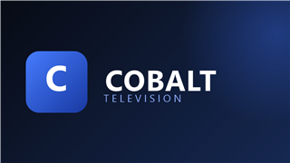
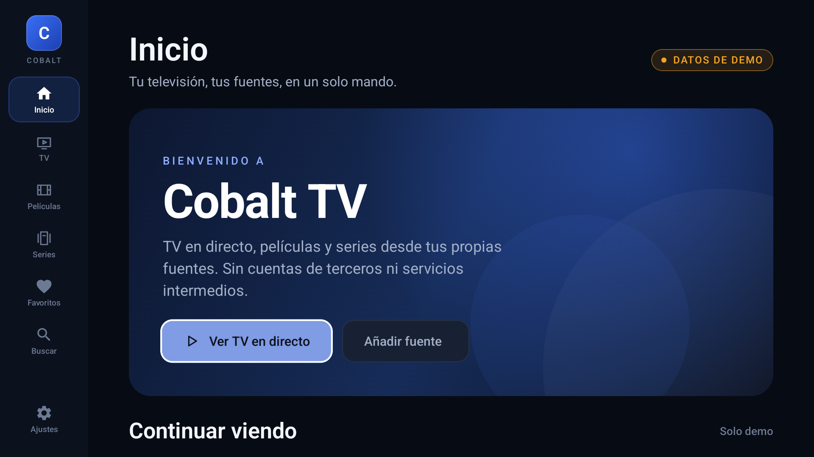
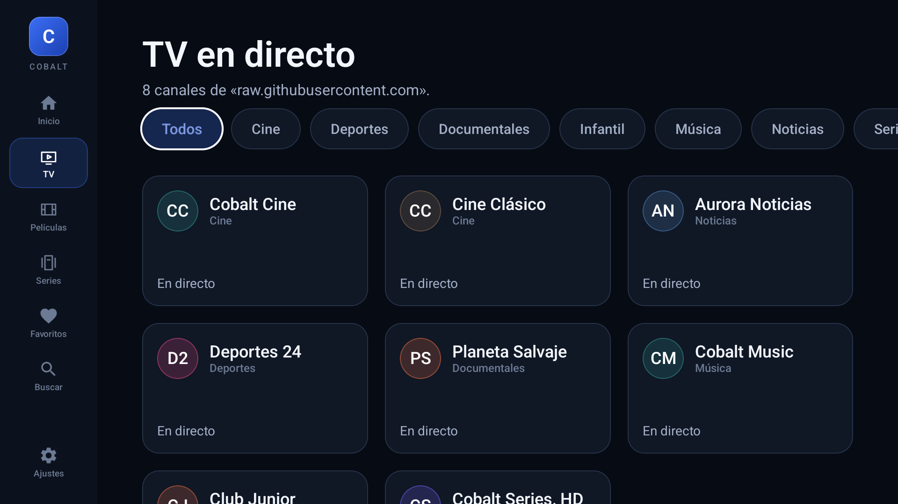
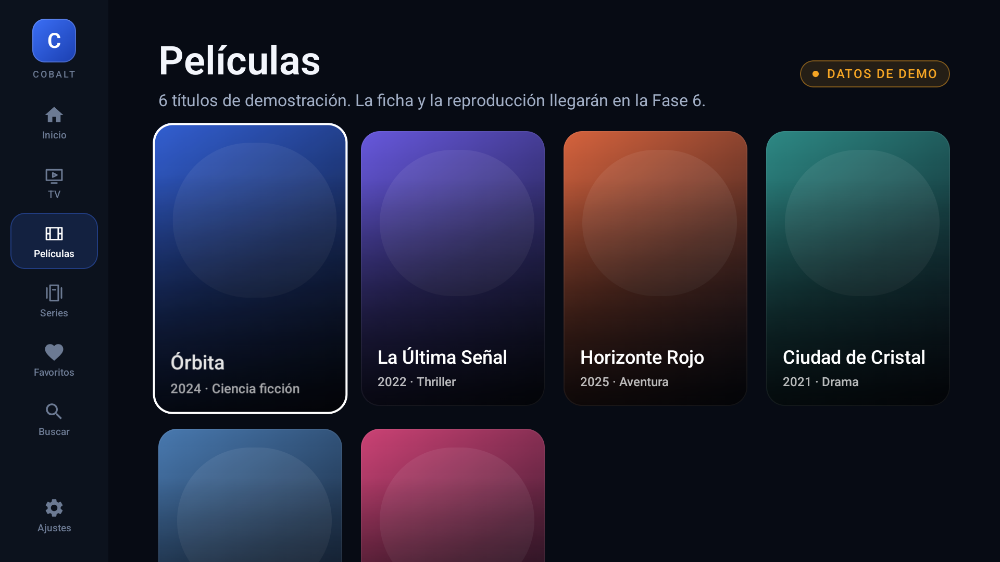
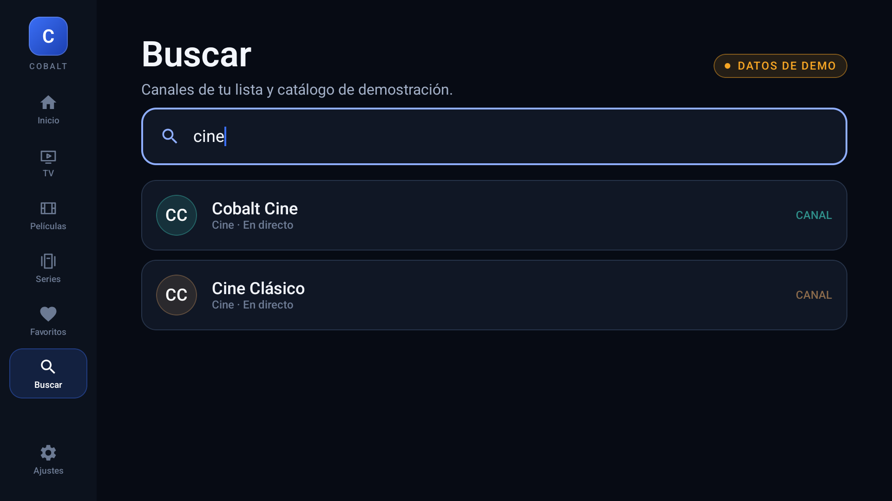
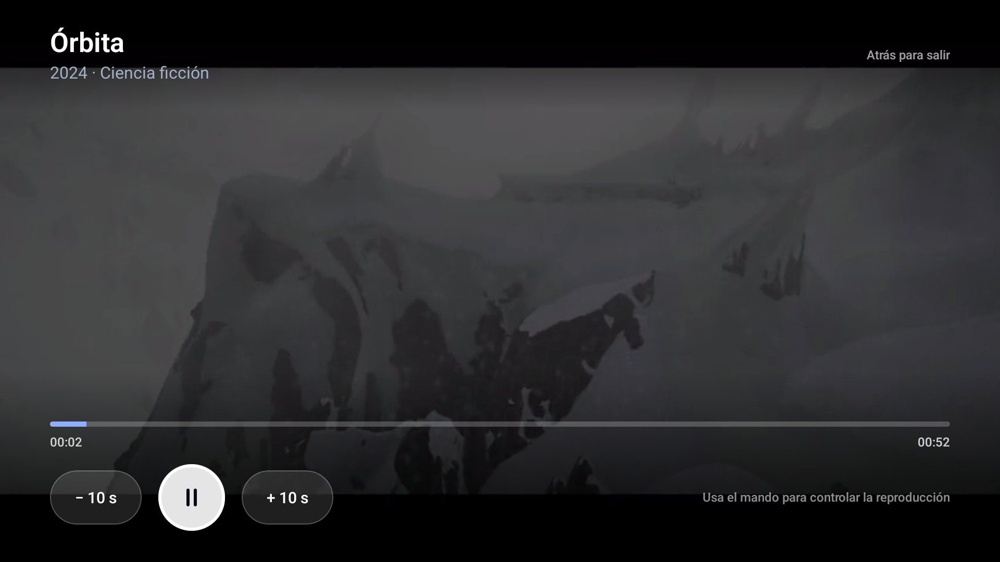
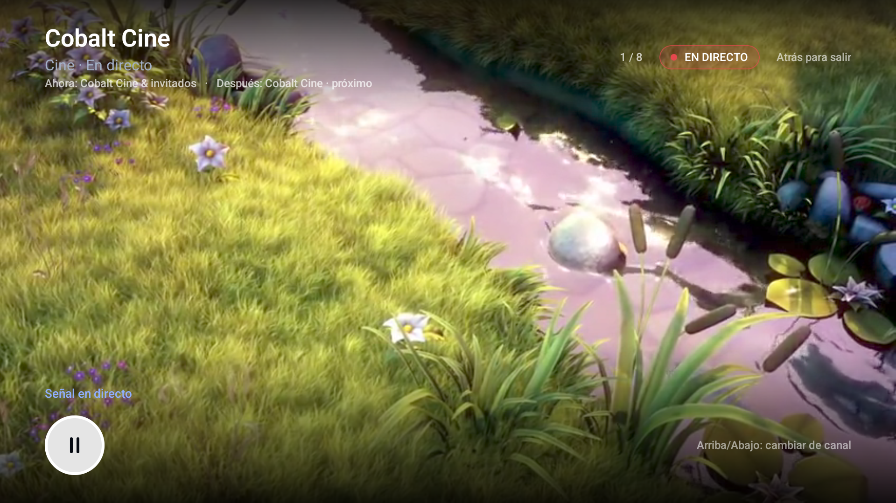
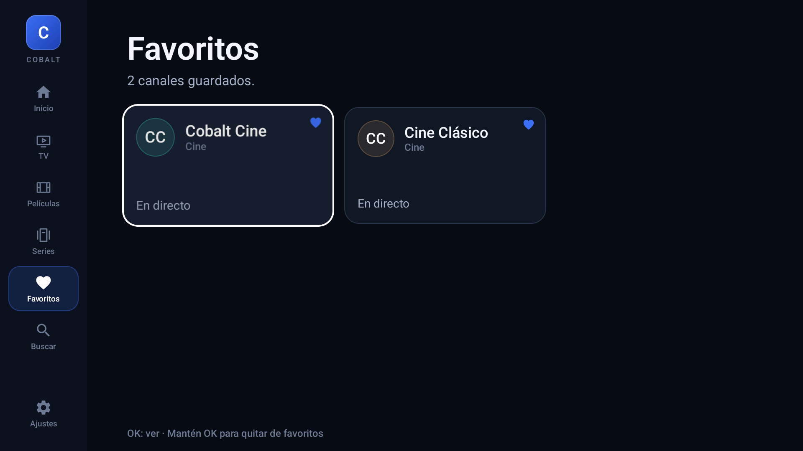
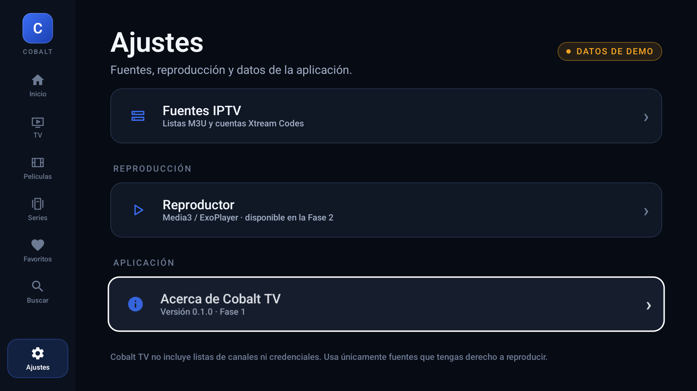

# Cobalt TV

Reproductor IPTV para Android TV, escrito en Kotlin con Jetpack Compose for TV y
Media3. Pensado para uso personal y un grupo pequeño de amigos: cada usuario
configura sus propias fuentes y reproduce contenido que tiene derecho a usar.

> **Estado: Fase 4 completada (TV en directo).** La app importa listas M3U/M3U8
> por URL (y por archivo con el selector del sistema), tolera metadatos
> incompletos y guarda la lista en el dispositivo. Los canales reales aparecen en
> TV en directo, Inicio y Búsqueda, con filtros por categoría y reproducción
> HLS/MP4. Incluye favoritos persistentes, zapping con el mando y EPG/XMLTV
> (ahora/siguiente) cuando la lista declara `url-tvg` o `x-tvg-url`. Xtream Codes
> llega en la Fase 5. Versión actual: **0.4.0**. Verificada en el emulador
> Android TV (API 36) con D-pad.



## Capturas

| Inicio | TV en directo |
| --- | --- |
|  |  |

| Películas | Buscar |
| --- | --- |
|  |  |

| Reproductor VOD | Reproductor en directo con EPG |
| --- | --- |
|  |  |

| Favoritos | Ajustes |
| --- | --- |
|  |  |

Más pantallas: [series](docs/screenshots/series.png),
[fuentes](docs/screenshots/sources.png) y
[error de reproducción](docs/screenshots/player-error.png).

## Qué hay ahora mismo

- Proyecto Android TV con `LEANBACK_LAUNCHER`, banner de TV e iconos propios.
- Tema oscuro cinematográfico (grafito + azul cobalto) y tipografía para sofá.
- Navegación lateral compacta con foco visible y orden predecible.
- Pantalla de inicio con hero, filas de "Continuar viendo", TV, películas y series.
- TV en directo con canales reales importados y filtros por categoría; si no hay
  fuente, muestra el catálogo demo.
- Películas y series con catálogo de pósteres (demo).
- Búsqueda sobre los canales importados y el catálogo demo, con teclado en pantalla.
- Importación M3U por URL y por archivo local (selector SAF del sistema), con
  lista de ejemplo incluida.
- Parser tolerante: BOM/CRLF, listas sin `#EXTM3U`, directivas desconocidas,
  comas entre comillas, `#EXTGRP`, URLs sueltas, deduplicación e IDs estables.
- Una fuente activa a la vez: importar otra sustituye la anterior. La lista se
  cachea en el dispositivo y se restaura al volver a abrir la app.
- Errores de descarga/parseo en español, límite de importación de 16 MB y sin
  registrar URLs ni credenciales.
- Reproductor Media3 a pantalla completa con HLS y MP4 progresivo.
- Controles con foco de TV: play/pausa, −10 s, +10 s, barra de progreso y tiempos.
- Autoocultado de controles a los 5 s, reaparición con cualquier tecla del mando.
- Indicador de buffering, badge EN DIRECTO, keep-screen-on y pausa al salir de la app.
- Panel de error con mensaje comprensible, Reintentar y Volver.
- BACK sale del reproductor y devuelve a la pantalla de origen con el foco restaurado.
- Favoritos persistentes de canales: mantén pulsado OK en Inicio, TV en directo o
  Favoritos; corazones, avisos y estados vacío/no disponibles.
- Zapping en directo con Arriba/Abajo o CH+/CH− dentro de la lista abierta
  (Todos, categoría, Inicio o Favoritos), con vuelta circular y contador n/total.
- EPG/XMLTV opcional: lee `url-tvg` o `x-tvg-url` del encabezado M3U, filtra los
  canales activos y una ventana de 24 h, y muestra ahora/siguiente en las
  tarjetas, la cabecera de TV y el reproductor. Si falta la guía o un programa,
  lo indica sin afectar a la reproducción.
- Fuentes con importar/actualizar/eliminar, estado de la guía y ajustes con el
  estado real de la lista.

Las tarjetas de demo, y los canales de la lista de ejemplo, abren el reproductor
con dos streams públicos de prueba: HLS (Big Buck Bunny, Mux) y MP4 progresivo
(tráiler de Sintel, W3C). No son canales reales y no se distribuye ningún
contenido de terceros.

## Stack

| Pieza | Versión |
| --- | --- |
| Kotlin | 2.4.21 |
| Android Gradle Plugin | 9.4.1 (Kotlin integrado) |
| Gradle | 9.6.0 |
| Compose BOM | 2026.09.00 |
| Compose for TV (`androidx.tv:tv-material`) | 1.1.0 |
| Navigation Compose | 2.10.2 |
| Media3 / ExoPlayer | 1.11.1 |
| OkHttp | 5.5.0 |
| compileSdk / targetSdk | 37 |
| minSdk | 24 |

Las versiones se consultaron en Google Maven y en la documentación oficial de
AGP antes de fijarlas. Están centralizadas en
[`gradle/libs.versions.toml`](gradle/libs.versions.toml).

> AGP 9 compila Kotlin por sí mismo (built-in Kotlin). El proyecto declara
> `kotlin-gradle-plugin` en el `buildscript` raíz para que el compilador de
> Kotlin y el plugin del compilador de Compose queden en la misma versión.

## Compilar

Requisitos: JDK 17 y el SDK de Android (platform 37 y build-tools 36.0.0).

```bash
./gradlew :app:assembleDebug
```

En Windows:

```powershell
.\gradlew.bat :app:assembleDebug
```

El APK queda en `app/build/outputs/apk/debug/app-debug.apk`.

Tests unitarios (parser M3U, parser XMLTV y normalización; 19 casos):

```powershell
.\gradlew.bat :app:testDebugUnitTest
```

`local.properties` con la ruta del SDK no se versiona.

## Importar una lista

1. Abre **Fuentes** desde Inicio (*Añadir fuente*) o Ajustes.
2. Pega la URL de una lista M3U/M3U8 y pulsa **Importar lista**, o elige un
   archivo guardado con **Elegir archivo…**.
3. La lista se guarda en el dispositivo y aparece como fuente activa.
   **Ver TV en directo** abre los canales.

Para probar sin una lista real, usa la lista de ejemplo: son 8 canales que
apuntan al stream público de pruebas de Mux. Pega esta URL en **Fuentes**:

```text
https://raw.githubusercontent.com/gonzsanz/cobalt-tv/main/docs/sample-playlist.m3u
```

El archivo también está en
[`docs/sample-playlist.m3u`](docs/sample-playlist.m3u).

La app acepta listas con o sin `#EXTM3U`, atributos `tvg-id`, `tvg-name`,
`tvg-logo`, `group-title`, `url-tvg`/`x-tvg-url`, directivas `#EXTGRP` y URLs
sueltas. Solo hay una fuente activa; importar otra sustituye la anterior. La
lista se cachea en el almacenamiento privado de la app y no se envían datos a
servidores propios.

Si la cabecera declara una guía XMLTV, Cobalt TV descarga la guía y muestra
ahora/siguiente para los canales cuyo `tvg-id` coincide. Solo se conserva en
memoria una ventana de 24 h; la URL de la guía no se muestra ni se escribe en
los logs. La lista de ejemplo no declara EPG, así que con ella verás **En
directo**; para probar la guía usa una lista propia que incluya `url-tvg`.

En algunos televisores el selector de archivos del sistema no está disponible;
en ese caso usa la URL. La importación por archivo se probará en la Mi Box en la
Fase 8.

## Favoritos y zapping

- **Favorito:** mantén pulsado OK sobre un canal en Inicio, TV en directo o
  Favoritos. El corazón se rellena y aparece un aviso; repite para quitarlo.
- **Favoritos:** la pantalla del rail reúne los canales guardados y mantiene los
  IDs aunque cambies o borres la fuente. Si vuelve la misma lista, vuelven los
  favoritos; si no, muestra **Favoritos no disponibles**.
- **Zapping:** con un canal en directo, pulsa Arriba/Abajo o CH+/CH−. El salto se
  limita a la lista desde la que abriste el canal y da la vuelta al llegar al
  final. El contador de la cabecera (por ejemplo, **2 / 8**) indica la posición.
  En películas y series las flechas no cambian de contenido.

## Guía EPG (XMLTV)

- La fuente activa debe declarar `url-tvg="https://…/guide.xml"` o
  `x-tvg-url="…"` en la línea `#EXTM3U`, y los canales deben tener un `tvg-id`
  que coincida con el `channel` de la guía.
- La guía se descarga al importar o actualizar la lista y al arrancar la app si
  hay una fuente con EPG. Se limita a 32 MB, se parsea en streaming y se
  descartan los programas ya terminados o que empiezan después de 24 h.
- TV en directo muestra el estado de la guía en la cabecera y el programa actual
  en cada tarjeta; el reproductor añade **Ahora** y **Después**. Si la guía falla
  o no hay datos para un canal, la app mantiene la reproducción y muestra el
  estado correspondiente en vez de inventar programación.
- La guía no se guarda en disco y su URL se trata como privada, igual que la de
  la lista.

## Instalar en la Mi Box

1. Activa *Depuración USB/ADB* en la Mi Box (Ajustes → Información → compilar
   varias veces, luego Opciones de desarrollador).
2. PC y Mi Box en la misma red.
3. Conecta y autoriza:

```bash
adb connect <IP_DE_LA_MIBOX>:5555
adb install -r app/build/outputs/apk/debug/app-debug.apk
```

También puedes copiar el APK y abrirlo con un gestor de archivos o Downloader.

## Emulador de Android TV

```bash
sdkmanager "system-images;android-36;android-tv;x86_64"
avdmanager create avd -n CobaltTV -k "system-images;android-36;android-tv;x86_64" -d tv_1080p
emulator -avd CobaltTV
```

El emulador sirve para UI, foco, navegación y parser. La decodificación real, el
rendimiento y el mando se validan en la Mi Box.

## Estructura

```text
app/src/main/java/io/github/gonzsanz/cobalttv/
  MainActivity.kt
  core/designsystem/     tema, tipografía, foco, componentes, iconos
  core/playback/         petición de reproducción y sesión en memoria
  data/catalog/          modelos, parser M3U, repositorio y persistencia
  data/demo/             catálogo de demostración y streams de prueba
  data/epg/              modelos, parser XMLTV, repositorio y estado de la guía
  data/favorites/        favoritos persistentes por ID de canal
  feature/
    home/ live/ movies/ series/ favorites/ search/ settings/ sources/
    player/              reproductor Media3 y controles de TV
  ui/
    CobaltTvApp.kt       shell, navegación lateral, NavHost
    LocalCatalog.kt      CompositionLocal con el catálogo activo
    LocalEpg.kt          CompositionLocal con la guía EPG
    LocalFavorites.kt    CompositionLocal con los favoritos
    model/               mapeo de canales importados a la UI
    components/          tarjetas de contenido
    navigation/          destinos
```

La UI no conoce el formato M3U ni Xtream Codes: los importadores producen
`Channel` normalizados y el repositorio expone un `StateFlow` que las pantallas
observan. Añadir Xtream Codes en la Fase 5 no debería cambiar las pantallas.

## Fases

| Fase | Contenido | Estado |
| --- | --- | --- |
| 1 | Proyecto, launcher TV, navegación, inicio, datos demo | ✅ |
| 2 | Media3: reproducción, controles, ciclo de vida, errores | ✅ |
| 3 | Importación M3U por URL y archivo + parser tolerante | ✅ |
| 4 | TV en directo: favoritos, zapping y EPG/XMLTV | ✅ |
| 5 | Xtream Codes (login, categorías, canales, VOD) | ⏳ |
| 6 | Películas y series: fichas, temporadas, episodios | ⏳ |
| 7 | Room, DataStore, caché de imágenes, pulido | ⏳ |
| 8 | Pruebas en Mi Box, APK firmado, distribución privada | ⏳ |

No se avanza de fase hasta que la anterior compila y se ha probado.

## Legal y privacidad

- El repositorio no incluye listas, credenciales ni streams de terceros. Solo
  incluye una lista de ejemplo con un stream público de pruebas.
- Usa solo fuentes que tengas derecho a reproducir.
- Las credenciales de Xtream Codes se guardarán en el dispositivo, nunca en el
  repositorio ni en logs.
- Las URLs de las fuentes y de la guía se tratan como datos privados: la lista
  se cachea en el almacenamiento de la app y ninguna de las dos se escribe en los
  logs.
- La app no envía datos a servidores propios ni incluye analítica.

El contexto completo del proyecto y las decisiones tomadas están en
[`docs/CONTEXT.md`](docs/CONTEXT.md).
